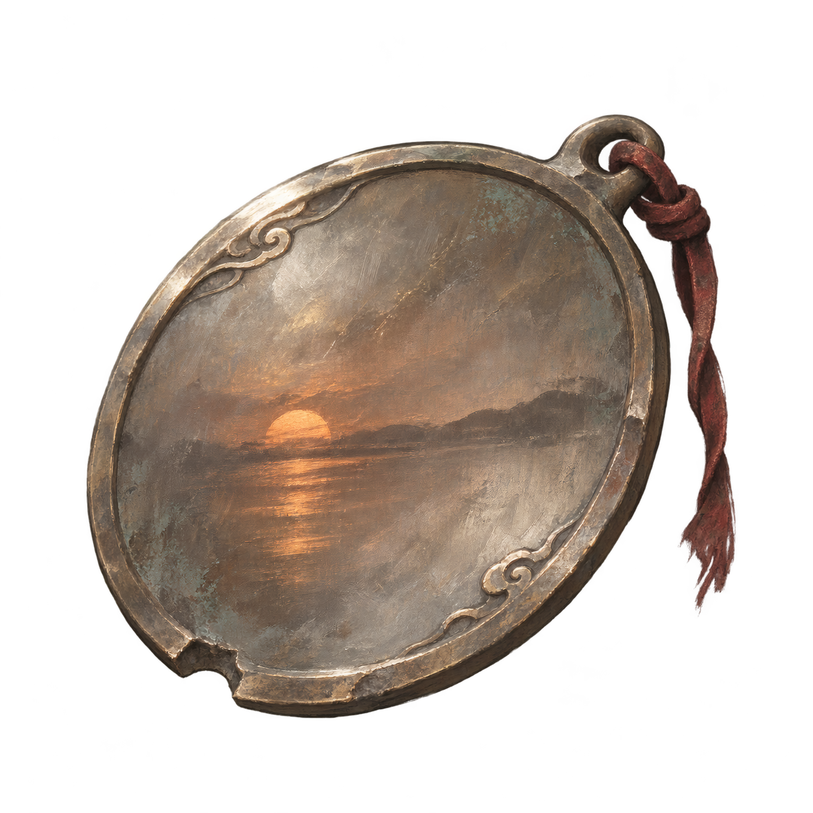

引壶觞心铸梦，执情义梦作身。湖天一镜妆残照，且叫刀兵劝故人。少主一战后，于陆家村湖畔升降梯出口附近使用回到残阳湖畔，靠近升降梯即可离梦。

# 梦中身 · 重返湖畔夕阳

**Dreambody — Revisit the Sunset**  
《影之刃零》模组 / A mod for **Phantom Blade Zero**

重返湖畔夕阳：与少主沐小葵对战之处。背包里的一面铜镜，让已经离去的残阳再次照在湖上。

Return to the lakeside at sunset, where you fought Mu Xiaokui. A bronze mirror in your inventory lets you revisit the light that was left behind.

[下载安装包 / Download](https://github.com/JoenardoQ/Phantom-Blade-Zero-Revisit-the-sunset/raw/refs/heads/main/downloads/Dreambody-v1.0.0-4K.zip) · [English instructions](#english) · [反馈问题 / Report an issue](https://github.com/JoenardoQ/Phantom-Blade-Zero-Revisit-the-sunset/issues) · [构建说明 / Build guide](docs/BUILD.md)

<p align="center"></p>

## 下载与安装

1. 点击 [安装包下载链接](https://github.com/JoenardoQ/Phantom-Blade-Zero-Revisit-the-sunset/raw/refs/heads/main/downloads/Dreambody-v1.0.0-4K.zip)。
2. 保存 **`Dreambody-v1.0.0-4K.zip`**；若浏览器打开文件预览页，点击 **Download raw file** 下载。GitHub 自动生成的 `Source code (zip)` / `Source code (tar.gz)` 是源码，不是可直接安装的模组。
3. 完全退出游戏。在 Steam 库中右键《影之刃零》→ **管理 → 浏览本地文件**。
4. 进入 `ProjectPBZ\Content\Paks`，把下载包里的 **`~mods` 文件夹**解压到这里。若已有同名文件夹，将内容合并。
5. 确认下面三个文件位于同一层，再启动游戏：

```text
PBZ/
└─ ProjectPBZ/
   └─ Content/
      └─ Paks/
         └─ ~mods/
            ├─ DreamBody_P.pak
            ├─ DreamBody_P.utoc
            └─ DreamBody_P.ucas
```

**没有 EXE 安装器，不需要额外模组加载器。** 普通玩家只需安装这三个文件；`Dreambody-4K.png` 是可选的美术资源，游戏内贴图已经包含在安装包中。

更新时先退出游戏，再覆盖同名的三个文件。请保留其他模组的文件，避免出现多套旧版 DreamBody 文件。

## 如何使用

打开背包 **「道具」→「全部」或「剧情道具」**，找到第一格的 **「梦中身」**。按界面显示的使用键操作；键盘默认提示为 **Space**。

| 当前状态 | 使用结果 |
| --- | --- |
| 尚未战胜少主，且不在夕阳战场内 | 显示「请待斜阳水畔见故人。」 |
| 已战胜少主，位于陆家村湖畔升降梯出口附近 | 倒放原版坍塌动画，带当前可操控角色重返残阳湖畔 |
| 已在夕阳战斗场景内 | 显示「隙中驹，石中火，梦中身。」，留在原处 |
| 不在规定的出口附近，或正在战斗 | 显示相应提示，不能入梦 |

入梦后可以自由走动。**靠近湖畔升降梯出口即可离梦**：正向播放坍塌动画，然后回到本次使用道具时的位置与朝向。梦境结束后，需再次使用「梦中身」才能重返。

过场期间会暂时屏蔽菜单与常规操作，播放完毕后恢复，避免 Esc 等输入打断流程。请等待动画结束。

## 主要功能

- **跨存档显示、反复使用**：运行时在背包界面加入道具格，不消耗次数。
- **复用原版场景与动画**：进入时倒放坍塌，离开时正放坍塌；保留当前可操控角色。
- **双向过场站姿**：入梦与离梦的过场人物都复用魂的原版站立循环。
- **4K 铜镜贴图**：由原图超分辨率放大，游戏内为 **4096 × 4096、BC7、带透明通道**。
- **自动本地化**：名称、说明、诗句和提示跟随游戏的界面语言。
- **便于排查**：包含有大小限制的独立调试日志。

## 存档与兼容性

模组在背包界面加入一个可使用的虚拟道具，**不向真实背包写入永久物品，不直接读写存档文件，也不改写剧情标记**。使用条件依据当前游戏状态判断，因此可在不同存档中显示。游戏自身的正常保存机制仍然存在。

已在 **Windows Steam 构建号 26266538** 上验证。其他版本及后续游戏更新尚未验证。

模组覆盖背包界面脚本 `UI/Widget/NewInventory.js` 和道具数据表 `DT_InventoryData`；其他覆盖同一资源的模组可能发生冲突。当前数据表保留原版条目，并加入梦中身条目。

## 支持语言

资源包含 **16 种语言**：简体中文、繁体中文、英语、日语、韩语、法语、德语、意大利语、西班牙西语、拉丁美洲西语、葡萄牙葡语、巴西葡语、俄语、泰语、越南语、希伯来语。自动跟随**游戏界面语言**，可选语言以游戏菜单为准。

## 常见问题与日志

- **背包里找不到道具**：检查目录层级，确认三个文件均已安装，并完全重启游戏；再查看「全部」或「剧情道具」。若仍不显示，检查是否有覆盖背包界面的其他模组。
- **提示未能进入回忆**：先退出背包，等场景加载完成，确认已战胜少主并站在湖畔升降梯出口附近，再试一次。
- **如何反馈**：在 [Issues](https://github.com/JoenardoQ/Phantom-Blade-Zero-Revisit-the-sunset/issues) 写明游戏构建号、使用地点、是否已战胜少主、复现步骤和其他已安装模组；可附截图及对应日志片段。

调试文件位于游戏实际使用的 `Saved\Logs` 目录：

```text
DreamBody-debug.log
DreamBody-debug.previous.log
```

当前日志记录使用条件、过场阶段、角色状态及错误；上一轮日志在下一次加载时保留。分享前请检查内容，只提交与问题有关的片段，**不需要上传存档**。

## 卸载

退出游戏，删除 `ProjectPBZ\Content\Paks\~mods` 内的 `DreamBody_P.pak`、`DreamBody_P.utoc`、`DreamBody_P.ucas`。重新启动游戏后，梦中身道具格随模组消失。

## 验证与源码

4K 贴图、新道具说明与入梦倒放已在独立测试存档中实机检查；往返流程、双向站姿和过场输入修正经使用者测试确认可用。源码包含针对站姿绑定、输入恢复、超时兜底与日志的自动化检查；这些检查不代替每个游戏版本上的实际游玩验证。

发布包不含 EXE、DLL、测试存档、私人日志或嵌套压缩包。文件校验值见 [`SHA256SUMS.txt`](SHA256SUMS.txt)。源码、补丁与构建方式见 [开发文档](docs/BUILD.md)。

---

## English

### About

**Dreambody — Revisit the Sunset** adds a reusable mirror to the Items menu. After the duel with Mu Xiaokui, use it near the lakeside lift exit in the Village of Lu to return to the sunset lakeside.

> With wine in hand, the heart forges a dream; with love and loyalty, the dream takes form. Lake and sky mirror the last light of day; let blades raise a toast to an old friend.

### Download and install

1. Click the [install archive download](https://github.com/JoenardoQ/Phantom-Blade-Zero-Revisit-the-sunset/raw/refs/heads/main/downloads/Dreambody-v1.0.0-4K.zip).
2. Save **`Dreambody-v1.0.0-4K.zip`**. If GitHub shows a file preview instead, click **Download raw file**. GitHub's automatically generated **Source code** archives are for development, not installation.
3. Close the game. In your Steam library, right-click Phantom Blade Zero → **Manage → Browse local files**.
4. Extract the archive's `~mods` folder into `ProjectPBZ\Content\Paks`.
5. Check that `DreamBody_P.pak`, `DreamBody_P.utoc` and `DreamBody_P.ucas` are all inside `ProjectPBZ\Content\Paks\~mods`, then launch the game.

No EXE installer or additional mod loader is required. The optional `Dreambody-4K.png` artwork download is not needed to play. When updating, close the game and replace the three matching files, keeping other mods intact.

### How to use

- Open **Items → All** or **Story Items**, select **Dreambody** in the first slot and press the displayed use button (**Space** for the default keyboard prompt).
- Before defeating Mu Xiaokui, using it outside the sunset arena shows a localized story hint.
- After the duel, use it **near the lakeside lift exit in the Village of Lu**. The original collapse sequence plays in reverse, and your current playable character enters the sunset lakeside.
- Walk toward the lift exit to leave. The collapse plays forward, and you return to the position and orientation where you used the mirror. Use Dreambody again for another visit.
- Using it within the sunset arena displays a localized verse and leaves you in place. Entering a dream is unavailable in combat or away from the designated entrance.

Menu and normal input are temporarily suspended during the cinematic and restored afterward. Let the sequence finish.

### Features and requirements

The item appears across saves without being permanently granted to the inventory. Both cinematics reuse Soul's original idle animation. The bronze mirror has an **upscaled 4096 × 4096 BC7 texture with transparency**. Names, descriptions and messages follow the game's UI language, with resources for all 16 languages listed above.

Tested on **Windows Steam build 26266538**. Other builds are unverified. The mod replaces the inventory UI script and `DT_InventoryData`, so other mods replacing those resources may conflict.

The mod does not directly read or write save files or rewrite story flags. The game's normal saving system remains active.

### Troubleshooting and uninstall

If the item is missing, check all three files and the folder layout, restart the game, and check for inventory-mod conflicts. If entering fails, close the inventory, let the scene finish loading, confirm your story progress and position, then retry.

For reports, include the game build, location, story progress, reproduction steps and other installed mods. The actual game `Saved\Logs` folder contains `DreamBody-debug.log` and `DreamBody-debug.previous.log`. Review logs before sharing relevant excerpts; save files are not required.

To uninstall, close the game and remove only the three `DreamBody_P` files from `ProjectPBZ\Content\Paks\~mods`.

### Source and verification

The 4K artwork, updated description and reverse entry sequence were checked in-game using a separate test save. The return flow, both standing poses and cinematic input fixes have also been confirmed by the tester. Automated behavior checks cover animation binding, input cleanup, timeout handling and bounded logging. They do not establish compatibility with every game build.

See the [build guide](docs/BUILD.md), [release notes](CHANGELOG.md) and [SHA-256 checksums](SHA256SUMS.txt). The install archive contains no executables, DLLs, test saves, private logs or nested archives.

## 致谢 / Credits

- **S-GAME**：《影之刃零》的原版场景、角色与动画 / the game's original environments, characters and animations.
- **[retoc](https://github.com/trumank/retoc)** by trumank：IoStore 资源打包与校验 / IoStore packing and verification.
- **[Upscayl](https://github.com/upscayl/upscayl)**：铜镜美术超分辨率放大 / artwork upscaling.
- Unreal Engine 工具链 / Unreal Engine tooling：资源压缩与封装 / asset compression and packaging.

这是非官方玩家模组，与 S-GAME 无隶属或认可关系。原版游戏内容的权利归各自权利人所有。

This is an unofficial fan mod, not affiliated with or endorsed by S-GAME. Original game content belongs to its respective rights holders.
